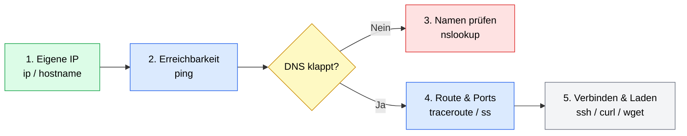

(linux-netzwerk)=
# Netzwerk

Wichtige Befehle zur Analyse, Überprüfung und Verwaltung von Netzwerkverbindungen unter Linux.

```{admonition} Kurzcheck: Was willst du tun?
:class: tip

- Bin ich im Netz? `ip` / `hostname` → [](#linux-net-eigen)
- Ist der Server online? `ping` / `nslookup` / `traceroute` → [](#linux-net-testen)
- Welche Ports sind offen? `ss` / `netstat` → [](#linux-net-ports)
- Verbinden & Daten laden? `ssh` / `curl` / `wget` → [](#linux-net-transfer)
```

(linux-net-uebersicht)=
## Übersicht

| Befehl | Bedeutung |
| :--- | :--- |
| `ip a` | Eigene Netzwerkkarten und IP-Adressen anzeigen |
| `hostname` | Gerätenamen des Systems anzeigen |
| `ping 8.8.8.8` | Erreichbarkeit eines Ziels testen |
| `nslookup domain` | Domain in eine IP-Adresse auflösen (DNS) |
| `traceroute ziel` | Weg der Datenpakete bis zum Ziel verfolgen |
| `ss -tuln` | Offene Ports und aktive Verbindungen anzeigen |
| `ssh user@host` | Verschlüsselt auf einen anderen Server verbinden |
| `curl url` | Webseiten oder APIs im Terminal abrufen |
| `wget url` | Dateien aus dem Internet herunterladen |

Als Ablauf bei der Fehlersuche – von deinem System aus nach aussen:



(linux-net-eigen)=
## Eigene Netzwerkkonfiguration

(linux-net-ip)=
### `ip`

Zeigt Netzwerkinformationen, Interfaces und IP-Adressen an. Ersetzt den veralteten Befehl `ifconfig`.

```bash
ip addr show
```

**Kurzform (im Alltag am häufigsten):**

```bash
ip a
```

| Befehl | Zeigt |
| :--- | :--- |
| `ip a` | Alle Netzwerkschnittstellen und IP-Adressen |
| `ip route` | Routing-Tabelle und Standard-Gateway (Router) |
| `ip link` | Status der Netzwerkkarten (UP / DOWN) |

(linux-net-hostname)=
### `hostname`

Zeigt den Hostnamen (Gerätenamen) des aktuellen Systems an.

```bash
hostname
```

```text
server01
```

```{admonition} Tipp
:class: tip

Mit `hostname -I` (grosses i) werden dir direkt alle IP-Adressen deines Rechners ohne Zusatztext ausgegeben.
```

(linux-net-testen)=
## Verbindung & DNS testen

(linux-net-ping)=
### `ping`

Prüft über Testpakete (ICMP), ob ein Host oder Server erreichbar ist.

```bash
ping 8.8.8.8
```

**Auf 4 Pakete begrenzen:**

```bash
ping -c 4 google.ch
```

```{admonition} Achtung: Endlosschleife
:class: warning

Unter Linux läuft `ping` ohne `-c` endlos weiter. Beende den Vorgang mit `Strg + C` (mehr dazu unter {doc}`prozesse`).
```

(linux-net-nslookup)=
### `nslookup`

Fragt DNS-Informationen zu einem Hostnamen ab und zeigt die zugehörige IP-Adresse.

```bash
nslookup github.com
```

Funktioniert [](#linux-net-ping) auf eine IP (`8.8.8.8`), aber nicht auf eine Domain (`google.ch`), liegt ein DNS-Problem vor.

(linux-net-traceroute)=
### `traceroute`

Zeigt den genauen Weg (alle Zwischenstationen / Hops) der Netzwerkpakete bis zum Zielsystem.

```bash
traceroute 8.8.8.8
```

```{admonition} Hinweis
:class: note

Auf einigen Linux-Systemen ist `traceroute` nicht vorinstalliert und muss zuerst über den Paketmanager nachinstalliert werden (siehe {doc}`basics`).
```

(linux-net-ports)=
## Ports & aktive Verbindungen

(linux-net-ss)=
### `ss`

Zeigt offene Ports und aktive Netzwerkverbindungen an. Moderner und schneller Ersatz für [](#linux-net-netstat).

```bash
ss -tuln
```

| Option | Bedeutung |
| :--- | :--- |
| `-t` | TCP-Verbindungen anzeigen |
| `-u` | UDP-Verbindungen anzeigen |
| `-l` | Listening (nur Ports, die auf Verbindungen warten) |
| `-n` | Numerisch (Portnummern statt Dienstnamen anzeigen) |

(linux-net-netstat)=
### `netstat`

Der klassische Vorgänger von [](#linux-net-ss) zur Anzeige von Netzwerkverbindungen.

```bash
netstat -tuln
```

| Befehl | Status | Empfehlung |
| :--- | :--- | :--- |
| `ss` | {bdg-success}`aktuell` | Standard auf modernen Linux-Systemen |
| `netstat` | {bdg-warning}`veraltet` | Oft nicht mehr vorinstalliert |

(linux-net-transfer)=
## Fernzugriff & Datentransfer

(linux-net-ssh)=
### `ssh`

Stellt eine verschlüsselte Verbindung zu einem entfernten Linux-System her.

```bash
ssh noemi@192.168.1.100
```

**Abweichenden Port angeben (Standard ist Port 22):**

```bash
ssh -p 2222 noemi@192.168.1.100
```

(linux-net-curl)=
### `curl`

Ruft Daten von Webseiten oder APIs ab und gibt die Antwort direkt im Terminal aus.

```bash
curl [https://api.github.com](https://api.github.com)
```

**Nur HTTP-Header und Statuscode prüfen:**

```bash
curl -I [https://google.ch](https://google.ch)
```

(linux-net-wget)=
### `wget`

Lädt Dateien aus dem Internet herunter und speichert sie im aktuellen Verzeichnis (siehe {doc}`navigation`).

```bash
wget [https://example.com/setup.zip](https://example.com/setup.zip)
```

**Abgebrochenen Download fortsetzen:**

```bash
wget -c [https://example.com/setup.zip](https://example.com/setup.zip)
```

- [](#linux-net-curl) eignet sich zum Testen von APIs und Weiterverarbeiten im Terminal.
- [](#linux-net-wget) ist speziell für das direkte Herunterladen von Dateien gemacht.

(linux-net-fehler)=
## Häufige Fehler

| Meldung | Ursache | Lösung |
| :--- | :--- | :--- |
| `Name or service not known` | Tippfehler in der Domain oder kein DNS | Domain prüfen und mit [](#linux-net-nslookup) testen |
| `Connection refused` | Server erreichbar, aber Dienst/Port läuft nicht | Auf dem Zielserver offene Ports mit [](#linux-net-ss) prüfen |
| `Network is unreachable` | Keine aktive Netzwerkverbindung / kein Gateway | Eigene IP und Route mit [](#linux-net-ip) prüfen |
| `command not found` | Tool (z. B. `traceroute`) fehlt | Paket über den Paketmanager installieren ({doc}`basics`) |

(linux-net-ablauf)=
## Beispiel: Ein kleiner Ablauf

```bash
ip a                          # Eigene IP-Adresse prüfen
ping -c 3 8.8.8.8             # Internetverbindung testen
nslookup github.com           # DNS-Auflösung testen
ss -tuln                      # Eigene offene Ports checken
ssh noemi@192.168.1.100       # Auf Zielserver verbinden
```

Laufende Netzwerkdienste und Prozesse verwalten: {doc}`prozesse`.

```{admonition} Merksätze
:class: important

1. `ip a` zeigt deine eigene IP, `hostname -I` gibt sie kompakt aus.
2. `ping` testet Erreichbarkeit – unter Linux mit `-c` begrenzen oder mit `Strg + C` stoppen.
3. Klappt `ping 8.8.8.8`, aber `ping google.ch` nicht, liegt es am DNS (`nslookup`).
4. `ss -tuln` ersetzt das veraltete `netstat` für offene Ports.
5. `ssh` verbindet auf fremde Server, `curl` testet APIs, `wget` lädt Dateien herunter.
```

## Weiterführend (offizielle Dokumentation)

- [ip(8) (man7.org)](https://man7.org/linux/man-pages/man8/ip.8.html): Netzwerkschnittstellen und Routing verwalten
- [hostname(1) (man7.org)](https://man7.org/linux/man-pages/man1/hostname.1.html): System-Hostnamen anzeigen und setzen
- [ping(8) (man7.org)](https://man7.org/linux/man-pages/man8/ping.8.html): ICMP-Echo-Anfragen senden
- [nslookup(1) (linux.die.net)](https://linux.die.net/man/1/nslookup): DNS-Server abfragen
- [traceroute(8) (linux.die.net)](https://linux.die.net/man/8/traceroute): Paketweg im Netzwerk verfolgen
- [ss(8) (man7.org)](https://man7.org/linux/man-pages/man8/ss.8.html): Sockets und offene Ports untersuchen
- [ssh(1) (man7.org)](https://man7.org/linux/man-pages/man1/ssh.1.html): OpenSSH-Client für sichere Verbindungen
- [curl(1) (curl.se)](https://curl.se/docs/manpage.html): Datenübertragung über URLs
- [GNU Wget Manual](https://www.gnu.org/software/wget/manual/wget.html): Dateien nicht-interaktiv herunterladen

Zurück zu den Grundlagen: {doc}`basics`
