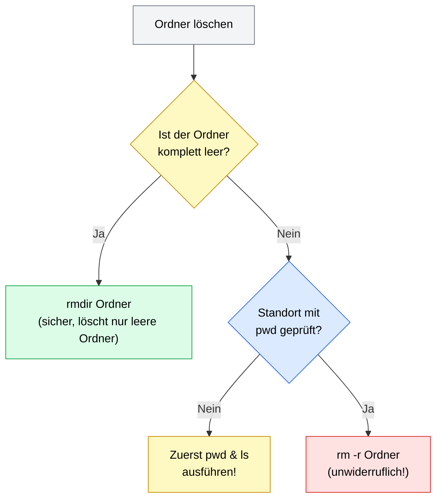

(linux-ordner)=
# Ordner

Verzeichnisse (Ordner) strukturieren deine Dateien unter Linux. Mit wenigen Grundbefehlen kannst du Ordner erstellen, kopieren, verschieben, umbenennen und sicher wieder löschen.

```{admonition} Kurzcheck: Was willst du tun?
:class: tip

- Neuen Ordner anlegen? `mkdir` → [](#linux-ord-erstellen)
- Ordner kopieren, verschieben oder umbenennen? `cp` / `mv` → [](#linux-ord-verwalten)
- Leeren oder vollen Ordner löschen? `rmdir` / `rm -r` → [](#linux-ord-loeschen)
```

(linux-ord-uebersicht)=
## Übersicht

| Befehl | Bedeutung |
| :--- | :--- |
| `mkdir Ordner` | Neuen Ordner erstellen |
| `mkdir -p A/B/C` | Ganze Ordnerstruktur inklusive Unterordner erstellen |
| `cp -r Quelle Ziel` | Ordner inklusive Inhalt kopieren (`-r` = rekursiv) |
| `mv Quelle Ziel` | Ordner verschieben oder umbenennen |
| `rmdir Ordner` | Nur einen **leeren** Ordner löschen |
| `rm -r Ordner` | Ordner **samt gesamtem Inhalt** unwiderruflich löschen |

Welcher Löschbefehl passt zu deiner Situation?



(linux-ord-erstellen)=
## Ordner erstellen

(linux-ord-mkdir)=
### `mkdir`

Erstellt ein oder mehrere neue Verzeichnisse (*make directory*).

```bash
mkdir Projekte
```

**Verschachtelte Unterordner auf einmal erstellen (`-p`):**

```bash
mkdir -p Schule/Linux/Befehle
```

| Option | Bedeutung |
| :--- | :--- |
| `-p` | *parents* – erstellt fehlende übergeordnete Ordner automatisch mit und meldet keinen Fehler, falls der Ordner schon existiert |
| `-v` | *verbose* – gibt für jeden erstellten Ordner eine Bestätigung aus |

```{admonition} Tipp: Mehrere Ordner gleichzeitig
:class: tip

Mit geschweiften Klammern legst du mehrere Ordner in einem Schritt an: `mkdir -p Projekt/{src,docs,tests}`.
```

(linux-ord-verwalten)=
## Kopieren, Verschieben & Umbenennen

(linux-ord-cp)=
### `cp`

Kopiert Dateien oder ganze Verzeichnisse (*copy*). Für Ordner ist die Option `-r` (*rekursiv*) zwingend nötig.

**Einzelne Datei kopieren (siehe auch {doc}`dateien`):**

```bash
cp bericht.txt kopie.txt
```

**Ganzen Ordner inklusive Unterordner kopieren:**

```bash
cp -r Projekte Backup
```

| Befehl | Ergebnis |
| :--- | :--- |
| `cp -r Projekte Backup` | Kopiert `Projekte` nach `Backup` (erstellt `Backup`, falls nicht vorhanden) |
| `cp -rp Projekte Backup` | Kopiert den Ordner und behält Zeitstempel sowie Berechtigungen bei (siehe {doc}`dateirechte`) |

(linux-ord-mv)=
### `mv`

Verschiebt Dateien und Ordner an einen neuen Ort oder benennt sie um (*move*). Im Gegensatz zu [](#linux-ord-cp) braucht `mv` bei Ordnern **kein** `-r`.

**Ordner umbenennen (bleibt im selben Verzeichnis):**

```bash
mv Projekt Projekt_Alt
```

**Ordner in ein anderes Verzeichnis verschieben:**

```bash
mv Projekt Dokumente/
```

```{admonition} Hinweis
:class: note

Existiert der Zielordner `Dokumente/` bereits, wird `Projekt` **hinein** verschoben (`Dokumente/Projekt`). Existiert `Dokumente` nicht, wird `Projekt` in `Dokumente` **umbenannt**.
```

(linux-ord-loeschen)=
## Ordner löschen

(linux-ord-rmdir)=
### `rmdir`

Löscht ausschliesslich **leere** Verzeichnisse (*remove directory*).

```bash
rmdir Projekte
```

| Eigenschaft | Verhalten |
| :--- | :--- |
| Ordner ist leer | Ordner wird sauber entfernt |
| Ordner enthält Dateien | Abbruch mit Fehlermeldung (`Directory not empty`) |

(linux-ord-rm)=
### `rm -r`

Löscht Dateien oder ganze Verzeichnisse inklusive aller Unterordner und Dateien (*remove*).

**Einzelne Datei löschen (siehe {doc}`dateien`):**

```bash
rm bericht.txt
```

**Ordner inklusive komplettem Inhalt löschen:**

```bash
rm -r Projekte
```

| Option | Wirkung | Gefahrenstufe |
| :--- | :--- | :--- |
| `rm -r Ordner` | Löscht Ordner und gesamten Inhalt rekursiv | {bdg-warning}`hoch` |
| `rm -ri Ordner` | Fragt vor jeder Datei/jedem Ordner nach Bestätigung | {bdg-success}`sicherer` |
| `rm -rf Ordner` | Erzwingt Löschung ohne Rückfragen oder Warnungen | {bdg-danger}`kritisch` |

```{admonition} Achtung: Kein Papierkorb!
:class: warning

Im Terminal gibt es **keinen Papierkorb**. Mit `rm -r` gelöschte Daten sind sofort und dauerhaft weg. Prüfe vor dem Ausführen immer mit `pwd` und `ls` (siehe {doc}`navigation`), ob du im richtigen Verzeichnis bist!
```

(linux-ord-fehler)=
## Häufige Fehler

| Meldung | Ursache | Lösung |
| :--- | :--- | :--- |
| `Directory not empty` | `rmdir` auf einen Ordner mit Inhalt angewendet | Inhalt zuerst prüfen (`ls -la`, auch versteckte Dateien!) oder [](#linux-ord-rm) nutzen |
| `omitting directory` | `cp` oder `rm` auf einen Ordner ohne `-r` ausgeführt | Option `-r` ergänzen (`cp -r` bzw. `rm -r`) |
| `File exists` | `mkdir` auf einen bereits vorhandenen Ordner | Option `-p` nutzen (`mkdir -p`) |
| `Permission denied` | Fehlende Schreibrechte im übergeordneten Ordner | Berechtigungen prüfen (siehe {doc}`dateirechte`) |

(linux-ord-ablauf)=
## Beispiel: Ein kleiner Ablauf

```bash
mkdir -p Schule/Linux/Uebungen    # Verschachtelte Ordner anlegen
cp -r Schule Schule_Backup        # Komplettes Backup erstellen
mv Schule/Linux/Uebungen Schule/  # Ordner eine Ebene nach oben verschieben
rmdir Schule/Linux                # Jetzt leeren Ordner sicher entfernen
rm -r Schule_Backup               # Backup-Ordner samt Inhalt löschen
```

Weiter mit einzelnen Dateien arbeiten: {doc}`dateien`. Berechtigungen auf Ordnern verwalten: {doc}`dateirechte`.

```{admonition} Merksätze
:class: important

1. `mkdir -p` erstellt ganze Ordnerpfade auf einmal, ohne Fehler bei bestehenden Ordnern.
2. `cp -r` braucht für Ordner immer `-r` (rekursiv) – `mv` braucht kein `-r`.
3. `mv` benennt um (gleicher Ort) oder verschiebt (anderer Zielordner).
4. `rmdir` löscht nur komplett leere Ordner (inklusive versteckter `.`-Dateien).
5. `rm -r` löscht alles ohne Papierkorb – vorher immer `pwd` und `ls` prüfen!
```

## Weiterführend (offizielle Dokumentation)

- [mkdir (GNU Coreutils)](https://www.gnu.org/software/coreutils/manual/html_node/mkdir-invocation.html): Verzeichnisse erstellen und `-p` nutzen
- [rmdir (GNU Coreutils)](https://www.gnu.org/software/coreutils/manual/html_node/rmdir-invocation.html): Leere Verzeichnisse entfernen
- [cp (GNU Coreutils)](https://www.gnu.org/software/coreutils/manual/html_node/cp-invocation.html): Dateien und Ordner kopieren
- [mv (GNU Coreutils)](https://www.gnu.org/software/coreutils/manual/html_node/mv-invocation.html): Dateien und Ordner verschieben oder umbenennen
- [rm (GNU Coreutils)](https://www.gnu.org/software/coreutils/manual/html_node/rm-invocation.html): Dateien und Verzeichnisse löschen

Zurück zur Navigation: {doc}`navigation`
