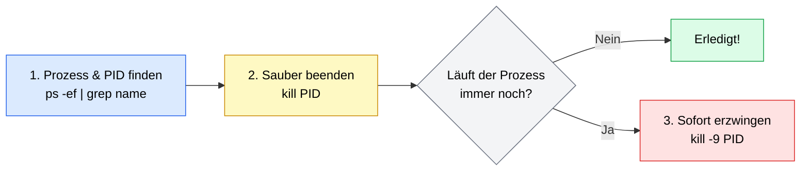

(linux-prozesse)=
# Prozesse

Prozesse sind laufende Programme oder Befehle. Linux weist jedem Prozess beim Start eine eindeutige Nummer zu – die **PID** (*Process ID*). Mit wenigen Befehlen kannst du laufende Prozesse anzeigen, überwachen, gezielt suchen und beenden.

```{admonition} Kurzcheck: Was willst du tun?
:class: tip

- Laufende Programme & PIDs sehen? `ps` / `top` → [](#linux-proz-anzeigen)
- Nach einem bestimmten Programm suchen? `ps -ef | grep` → [](#linux-proz-suchen)
- Hängenden Prozess stoppen? `kill` / `kill -9` → [](#linux-proz-beenden)
```

(linux-proz-uebersicht)=
## Übersicht

| Befehl | Bedeutung |
| :--- | :--- |
| `ps -ef` | Momentaufnahme aller laufenden Prozesse anzeigen |
| `ps aux` | Alle Prozesse inklusive CPU- und RAM-Auslastung anzeigen |
| `ps -ef \| grep name` | Gezielt nach einem Prozessnamen und seiner PID suchen |
| `top` | Prozesse und Systemauslastung in Echtzeit überwachen |
| `kill PID` | Prozess sauber beenden (fragt das Programm zum Beenden auf) |
| `kill -9 PID` | Prozess sofort erzwingen und beenden (Notfall-Stopp) |
| `Strg + C` | Aktuell im Vordergrund laufenden Terminal-Befehl abbrechen |

So gehst du vor, wenn ein Programm hängt oder beendet werden muss:



(linux-proz-anzeigen)=
## Prozesse anzeigen & überwachen

(linux-proz-ps)=
### `ps`

Zeigt eine statische Momentaufnahme der aktuell laufenden Prozesse (*process status*).

```bash
ps -ef
```

| Befehl | Zeigt |
| :--- | :--- |
| `ps` | Nur Prozesse im aktuellen Terminal-Fenster |
| `ps -ef` | Alle Prozesse des Systems mit Benutzer, PID, Eltern-PID (PPID) und Befehl |
| `ps aux` | Alle Prozesse mit detaillierter CPU- und Arbeitsspeicher-Nutzung (`%CPU`, `%MEM`) |

(linux-proz-top)=
### `top`

Zeigt laufende Prozesse und die aktuelle Systemauslastung (CPU, RAM, Laufzeit) **live in Echtzeit** an.

```bash
top
```

**Angezeigte Kennzahlen im Überblick:**
- **CPU-Auslastung:** Wie stark der Prozessor aktuell ausgelastet ist
- **Arbeitsspeicher (RAM & Swap):** Wie viel Speicher belegt und noch frei ist
- **PID & USER:** Prozess-ID und ausführender Benutzer (siehe auch {doc}`informationen`)
- **%CPU / %MEM:** Ressourcenverbrauch pro einzelnem Programm

```{admonition} Steuerung in top
:class: note

Mit der Taste `q` beendest du `top` und kehrst ins Terminal zurück. Mit `M` sortierst du nach RAM-Verbrauch, mit `P` nach CPU-Last.
```

(linux-proz-suchen)=
## Gezielt nach Prozessen suchen

Oft laufen hunderte Prozesse gleichzeitig. Mit einer Pipe (`|`) leitest du die Ausgabe von [](#linux-proz-ps) an `grep` weiter, um gezielt nach einem Namen zu filtern (mehr zur Suche unter {doc}`suche`).

```bash
ps -ef | grep python
```

**Beispielausgabe:**

```text
noemi     4809     1  0 14:20 ?        00:00:01 python main.py
noemi     5120  3910  0 14:25 pts/0    00:00:00 grep --color=auto python
```

| Wert | Spalte | Bedeutung |
| :--- | :--- | :--- |
| `noemi` | `UID` | Benutzer, dem der Prozess gehört |
| `4809` | `PID` | Eindeutige Prozess-ID (wird für [](#linux-proz-kill) benötigt) |
| `1` | `PPID` | *Parent PID* – die ID des übergeordneten Startprozesses |
| `python main.py` | `CMD` | Der ausgeführte Befehl samt Argumenten |

```{admonition} Tipp
:class: tip

In der Ausgabe taucht meistens auch der `grep`-Befehl selbst als eigene Zeile auf. Achte darauf, die PID deines eigentlichen Programms (`4809`) zu nehmen – nicht die von `grep` (`5120`).
```

(linux-proz-beenden)=
## Prozesse beenden

(linux-proz-kill)=
### `kill`

Sendet ein Beendigungssignal an einen laufenden Prozess anhand seiner **PID** (ermittelt über [](#linux-proz-ps) oder [](#linux-proz-top)).

**1. Normal und sauber beenden (`SIGTERM` / Signal 15):**

```bash
kill 4809
```

**2. Sofortiges Beenden erzwingen (`SIGKILL` / Signal 9):**

```bash
kill -9 4809
```

| Variante | Signal | Verhalten | Empfehlung |
| :--- | :--- | :--- | :--- |
| `kill 4809` | `SIGTERM` (15) | Bittet das Programm, sich sauber zu beenden und offene Dateien zu speichern | {bdg-success}`immer zuerst testen` |
| `kill -9 4809` | `SIGKILL` (9) | Der Linux-Kernel stoppt den Prozess sofort und ohne Rückfrage | {bdg-danger}`nur im Notfall` |

```{admonition} Achtung: Datenverlust bei kill -9
:class: warning

Bei `kill -9` hat das Programm **keine Chance mehr**, geöffnete Dateien zu speichern, Datenbanken sauber zu schliessen oder temporäre Dateien aufzuräumen. Nutze `kill -9` erst, wenn ein normales `kill PID` nicht funktioniert.
```

(linux-proz-fehler)=
## Häufige Fehler

| Meldung | Ursache | Lösung |
| :--- | :--- | :--- |
| `Operation not permitted` | Der Prozess gehört einem anderen Benutzer oder `root` | Mit `sudo kill PID` ausführen (siehe {doc}`dateirechte` / {doc}`basics`) |
| `No such process` | Die angegebene PID existiert nicht mehr (Prozess bereits beendet) | Mit [](#linux-proz-ps) aktuelle PID erneut prüfen |
| Prozess läuft nach `kill PID` weiter | Das Programm hängt fest und ignoriert das normale Signal | Mit `kill -9 PID` das sofortige Beenden erzwingen |

(linux-proz-ablauf)=
## Beispiel: Ein kleiner Ablauf

```bash
ps -ef | grep main.py         # PID des laufenden Python-Skripts herausfinden (z. B. 4809)
kill 4809                     # Prozess zuerst sauber beenden
ps -ef | grep 4809            # Prüfen, ob der Prozess noch läuft
kill -9 4809                  # Falls er noch hängt: sofort erzwingen
top                           # Systemauslastung anschliessend kontrollieren (mit q beenden)
```

Systeminformationen und Auslastung genauer prüfen: {doc}`informationen`. Dateien und Texte durchsuchen: {doc}`suche`.

```{admonition} Merksätze
:class: important

1. Jeder laufende Prozess hat eine eindeutige **PID** (Process ID).
2. `ps -ef | grep name` findet die PID eines bestimmten Programms.
3. `top` zeigt Prozesse und CPU-/RAM-Last live an – beendet wird es mit `q`.
4. Immer zuerst `kill PID` (sauber) versuchen, erst danach `kill -9 PID` (Notfall).
5. Ein direkt im Terminal laufender Befehl lässt sich meist mit `Strg + C` stoppen.
```

## Weiterführend (offizielle Dokumentation)

- [ps(1) (man7.org)](https://man7.org/linux/man-pages/man1/ps.1.html): Aktuelle Prozesse und deren Status anzeigen
- [top(1) (man7.org)](https://man7.org/linux/man-pages/man1/top.1.html): Linux-Prozesse und Systemressourcen in Echtzeit überwachen
- [kill(1) (man7.org)](https://man7.org/linux/man-pages/man1/kill.1.html): Signale an Prozesse senden
- [signal(7) (man7.org)](https://man7.org/linux/man-pages/man7/signal.7.html): Übersicht über Linux-Signale wie `SIGTERM` und `SIGKILL`

Zurück zu den Grundlagen: {doc}`basics`
